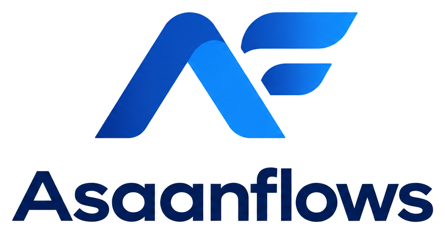

  <a href="https://asaanflows.com">
    <picture>
      <source media="(prefers-color-scheme: dark)" srcset="https://raw.githubusercontent.com/Asaanflows/.github/main/assets/logo-dark.png">
      
    </picture>
  </a>

<h3 align="center">Simplify. Automate. Grow.</h3>

  ERPNext implementation, custom Frappe apps, integrations and AI automation for businesses worldwide.

  
  
  

---

### 👋 About us

We help growing businesses replace scattered spreadsheets, emails and disconnected tools with one connected system on **ERPNext**: finance, inventory, sales, purchasing, manufacturing and HR in one place.

No per-user licence fees. A clear scope and a fixed price before we start.

### 🛠️ What we do

| | |
|---|---|
| **ERPNext implementation** | Setup, configuration, data migration and go-live |
| **Custom Frappe apps** | Features built as separate apps, so upgrades stay safe |
| **Integrations** | E-commerce, payment gateways, banks, WhatsApp, e-invoicing and more |
| **AI automation** | Chatbots on live ERP data, invoice reading, questions in plain English |
| **Upgrades and support** | Version upgrades, performance tuning and long-term support |

### 📦 What you'll find here

This is where we share our open-source **Frappe and ERPNext apps**. The first ones are on their way. Star or follow this page to see them when they land.

### 🧰 Built with

  
  
  
  
  
  
  

### 🤝 Work with us

Planning an ERP project, or stuck with one that isn't working? Tell us about it at **[asaanflows.com/contact](https://asaanflows.com/contact)**.
